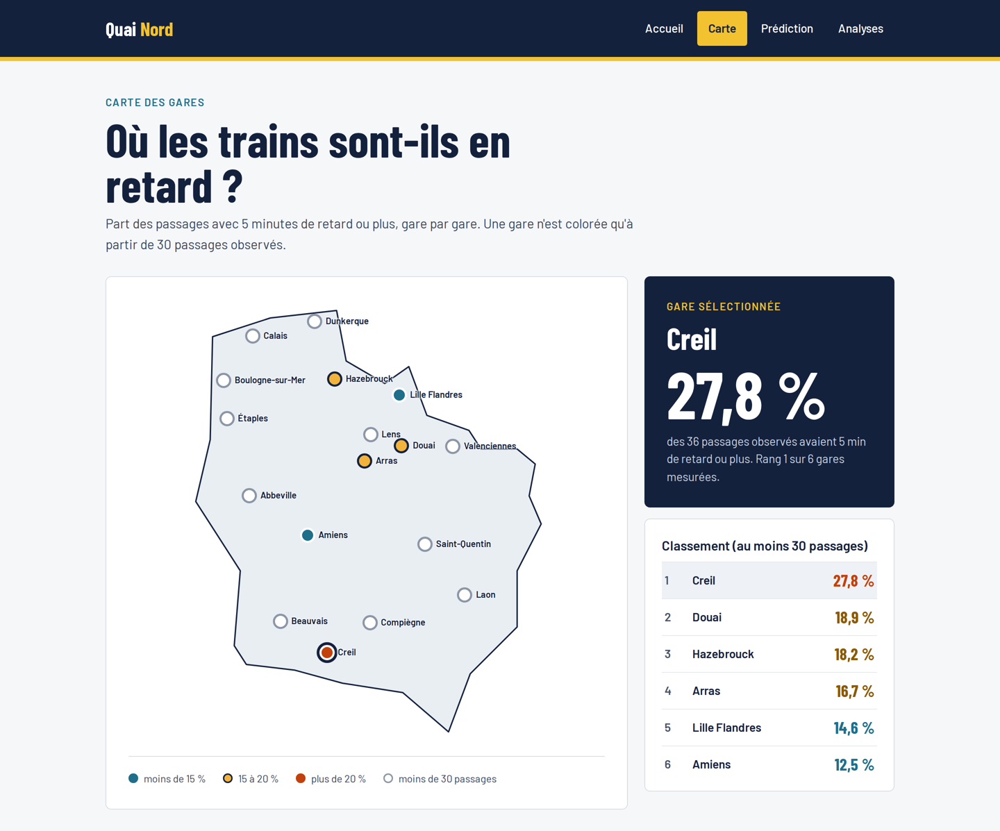

# Quai Nord 🚆

[](https://github.com/Aly2001/quai-nord/actions/workflows/tests.yml)

🇬🇧 [English version](README.en.md)

**Mon TER sera-t-il à l'heure ?** Un projet data de bout en bout sur les trains régionaux (TER) des Hauts-de-France, construit à partir des données ouvertes de la SNCF.

Quai Nord collecte en continu les données temps réel de la SNCF, construit une base propre des retards, analyse la ponctualité gare par gare, et la présente dans une application web React : le voyageur recherche un trajet et voit, pour chaque train, son risque de retard observé.



## Ce que fait le projet

- **Collecte en continu** : toutes les 5 minutes, un collecteur Python télécharge le flux temps réel de la SNCF (GTFS-RT) et enregistre chaque passage de train dans SQLite, sans doublons (upsert).
- **Pipeline quotidien automatisé** : chaque jour, les horaires officiels (GTFS), la météo heure par heure (Open-Meteo), la table des retards et les risques par train sont reconstruits, déclenchés par le collecteur lui-même.
- **Analyse exploratoire** : ponctualité par heure, par ligne, par gare et selon la position dans le trajet, avec des règles explicites de taille d'échantillon.
- **Application web (React)** :
  - recherche de trajet pour aujourd'hui, demain et après-demain, à partir de l'heure choisie ;
  - trains directs **et trajets avec une correspondance**, en ne gardant que les meilleures options ;
  - pour chaque train : le **risque de retard observé**, la **météo prévue** au départ et son **état en direct** (retard, suppression) ;
  - les **correspondances fragiles** signalées grâce aux données, et les **correspondances compromises** détectées en temps réel ;
  - une carte de ponctualité des gares et des pages d'analyse, avec la date de mise à jour des données toujours affichée.

## Premiers résultats (2 jours de données, à confirmer)

| Constat | Détail |
|---|---|
| Les retards vont par paliers de 5 minutes | Presque aucun retard de 1 à 4 minutes : les annonces sont arrondies. La cible du modèle est donc un seuil (retard ≥ 5 min), et non un nombre de minutes. |
| Le retard s'accumule au fil du trajet | 9,2 % des passages sont en retard à la première gare, 24,0 % après la quatorzième. |
| Un biais de sélection évité | Une collecte lancée à 21 h affichait 45 % de retard pour les trains de 14 h : seuls les trains en retard ou les longs trajets étaient encore dans le flux. Seules les périodes couvertes en continu sont analysées. |
| L'unité d'analyse compte | 17,6 % des passages en gare sont en retard, mais 22,3 % des trains à leur dernière gare observée. |

## Architecture

```
SNCF GTFS-RT (toutes les 5 min) ──► collecteur.py ──► sncf.db          (observations brutes)
                                         └──────────► temps_reel.json  (état en direct pour le site)

Chaque jour, déclenché par le collecteur (mettre_a_jour.py) :
  1. charger_gtfs.py        horaires SNCF            ──► gtfs.db
  2. collecter_meteo.py     météo Open-Meteo         ──► meteo.db, meteo.json
  3. exporter_horaires.py   horaires par gare et par jour, gares de correspondance ──► JSON
  4. construire_retards.py  table propre des retards, avec la météo ──► analyse.db
  5. exporter_risques.py    risque de retard observé par train, ligne et heure ──► risques.json

                          L'application React (site/) lit les fichiers JSON
```

## Technologies

Python · SQL (SQLite) · pandas · Matplotlib · GTFS / GTFS-RT · API REST (Open-Meteo) · React · React Router · Vite · CSS

## Lancer le projet

```bash
# 1. Partie Python
pip install -r requirements.txt
python collecteur.py          # tourne en continu : collecte + mise à jour quotidienne

# 2. Application web (dans un autre terminal)
cd site
npm install
npm run dev                   # http://localhost:5173
```

## Limites

- Seulement quelques jours de données pour l'instant : les résultats sont des premières tendances, pas des conclusions.
- Une correspondance au maximum par trajet, dans la même gare.
- Le risque affiché est le taux de retard **observé** (par train, puis par ligne et par heure) : ce n'est pas encore une prédiction par apprentissage automatique.
- Les causes des retards ne sont pas disponibles dans le flux.

## Suite du projet

- [ ] Modèle de prédiction : une référence avec scikit-learn, puis un modèle séquentiel TensorFlow qui suit la propagation du retard de gare en gare
- [ ] API FastAPI et déploiement avec Docker
- [ ] Collecte dans le cloud (24h/24) et mise en ligne du site
- [ ] Analyse météo et retards, quand plusieurs semaines de données seront disponibles

## Données et licences

Données : SNCF Voyageurs (GTFS et GTFS-RT), via transport.data.gouv.fr, sous licence ODbL.
Météo : Open-Meteo, sous licence CC BY 4.0.
Projet personnel, sans lien avec la SNCF.

---

**Aly Keita**, étudiant en Master 2 Ingénierie des Systèmes Complexes (EILCO, Calais), à la recherche d'un stage de 6 mois en Data Science / Data Engineering.
